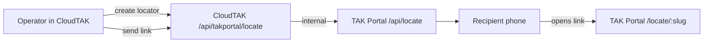

# CloudTAK Locator Plugin

CloudTAK menu plugin for **cellphone ping / RTT / email parse** and **TAK Portal SMS locator** management.

Cellphone plotting code is **vendored in this repository** (`lib/cellphone/`, `components/cellphone/PingForm.vue`). You do not need [cloudtak-plugin-cellphone](https://github.com/clptak/cloudtak-plugin-cellphone) installed separately.

## Tabs

| Tab | Description |
|-----|-------------|
| **Cellphone Data** | Cell ping, RTT timing advance, and carrier email parse |
| **SMS Locator** | Create/list/archive locators via TAK Portal; send share links via TAK Portal SMS |

A CloudTAK system admin sets the TAK Portal base URL for one TAK channel. CloudTAK stores that setting. A user can create locators when that channel is in their TAK channel list. The settings block sits under the tabs: channel pull-down, URL, **Test TAK Portal Connection**, **Save**, **Reset**.

## Prerequisites

1. **TAK Portal** with the locate feature and your user granted `page.locate` on the portal. Locator API calls use the **CloudTAK → TAK Portal bridge** (`/api/takportal/locate/*`) — no cross-origin browser auth. See [TAK Portal bridge (CloudTAK API)](#tak-portal-bridge-cloudtak-api). A system admin saves the **TAK Portal Base URL** and a TAK channel in CloudTAK (`PUT /api/locator/settings`). That URL is used for public share links (`/locate/{slug}`). Create is enabled when the saved channel is in the channel list CloudTAK already loaded. The plugin does not call `GET /api/marti/group` itself. If that local list is not ready yet, the form still opens and TAK Portal enforces the channel. CloudTAK loads it from `api/stateless/routes/locator-settings.ts`.

2. **TAK Portal Server Settings** — TAK URL/certs for relaying GPS pings to TAK Server, plus SMS provider credentials. The plugin does **not** store Twilio settings; it calls TAK Portal `POST /api/locate/locators/:id/send-link-sms`, which uses portal SMS configuration to build and send the link.

3. **CloudTAK HTTP proxy** is **not** required for locator SMS (only needed if you add other outbound integrations).

## Install

Only this plugin is required under `plugins/`:

```bash
git clone https://github.com/clptak/cloudtak-plugin-locator.git
ln -sf "$(pwd)/cloudtak-plugin-locator" ~/CloudTAK/api/web/plugins/locator
cd ~/CloudTAK/api/web && npm run serve
```

Open CloudTAK, load the map, and select **Locator** in the main menu.

On **desktop**, Locator opens as a free-floating, draggable/resizable pane over the map. Use **Minimize** in the pane header to hide it; open **Locator** from the main menu again to restore it at the same size and position. Use **Pop out** to open Locator in a child window. On **mobile**, Locator stays a full menu view (`MenuTemplate`).

If you previously installed `plugins/ping` (cloudtak-plugin-cellphone), you can remove that symlink — this plugin replaces it for the Cellphone Data tab.

## TAK Portal bridge (CloudTAK API)

The plugin calls **`/api/takportal/locate/*` on CloudTAK** (same origin). CloudTAK API forwards to internal TAK Portal (`http://tak-portal:3000/api/locate/*`) using the logged-in user's CloudTAK identity — no separate TAK Portal browser login and no CORS.

### CloudTAK API setup

Add route `CloudTAK/api/routes/takportal-locate.ts` and library `CloudTAK/api/lib/takportal-locate-bridge.ts` (included in CloudTAK when you merge/update), then rebuild **`cloudtak-api`**.

Environment variables on **`cloudtak-api`** (e.g. in `tak-stack/.env`):

| Variable | Purpose |
|----------|---------|
| `TAK_PORTAL_INTERNAL_URL` | Internal URL (default `http://tak-portal:3000`) |
| `TAK_PORTAL_BRIDGE_GLOBAL_GROUP` | Authentik group name injected for CloudTAK **system admins** — should match TAK Portal `PORTAL_AUTH_REQUIRED_GROUP` so they become portal global admins |
| `TAK_PORTAL_BRIDGE_EXTRA_GROUPS` | Optional `;`-separated groups added for **every** bridged request — must match TAK Portal `PORTAL_BRIDGE_MEMBER_GROUPS` (see below) |

**TAK Portal** (`~/tak-stack/.env` on the `tak-portal` container):

| Variable | Purpose |
|----------|---------|
| `PORTAL_BRIDGE_MEMBER_GROUPS` | Same Authentik group name(s) as `TAK_PORTAL_BRIDGE_EXTRA_GROUPS` (comma-separated). Lets bridged CloudTAK users pass portal auth **without** global admin — grants locate-only access. |
| `PORTAL_BRIDGE_MEMBER_PERMISSIONS` | Optional; default `page.locate` |

**TAK Portal patch required (until upstream merges it):** bridge members can create locators on their bridge channel only if TAK Portal includes the patch on [clptak/TAK-Portal `locate-bridge`](https://github.com/clptak/TAK-Portal/tree/locate-bridge) (`services/locatorAccess.service.js`, `mergeBridgeMemberChannels`; upstream [PR #63](https://github.com/AdventureSeeker423/TAK-Portal/pull/63)). Without it, create fails with `Channel not in your agency scope.` Updating TAK Portal to a release tag drops the patch, so re-apply it after every portal update.

**Permission mapping:** TAK Portal checks `page.locate` from portal roles/overrides. CloudTAK `system_admin` users get global portal admin when `TAK_PORTAL_BRIDGE_GLOBAL_GROUP` matches your portal admin group. Other users need matching groups in `TAK_PORTAL_BRIDGE_EXTRA_GROUPS` or per-user permission overrides in TAK Portal.

### Verify

After rebuilding CloudTAK API, sign in as a CloudTAK system admin, open **Locator**, and use **Test TAK Portal Connection** in the settings block under the tabs. It should return a locator count without visiting TAK Portal in another tab. Choose the TAK channel, enter the base URL, and **Save** so members of that channel can create locators.

---

## TAK Portal CORS (legacy direct browser calls)

<details>
<summary>Only needed if you bypass the bridge and call TAK Portal directly from the browser</summary>

The **SMS Locator** tab previously called TAK Portal directly from the browser with `credentials: 'include'`:

```js
fetch('https://takportal.example.com/api/locate/locators', { credentials: 'include' })
```

When CloudTAK and TAK Portal are on **different hosts** (e.g. `https://cloudtak.example.com` → `https://takportal.example.com`), the browser treats this as cross-origin and requires CORS. With Authentik `forward_auth` in front of TAK Portal, two things must be true:

1. The **`OPTIONS` preflight** for `/api/locate/*` must be answered **before** `forward_auth` — otherwise Authentik returns a `302` redirect to its login page and the preflight fails (no `Access-Control-*` headers). A failed preflight means the browser never sends the real request.
2. The **actual responses** (`GET`/`POST`/`PATCH`/`DELETE`) need `Access-Control-Allow-Origin` and `Access-Control-Allow-Credentials: true` after auth succeeds.

> You cannot use `Access-Control-Allow-Origin: *` together with credentials. Echo a specific origin instead.

### Caddyfile

Add the CORS handling **inside** your existing TAK Portal site block. Replace `cloudtak.{$PRIMARY_DOMAIN}` with your CloudTAK origin (and `tak-portal:3000` / `authentik-server-1:9000` with your upstreams):

```caddyfile
# TAK Portal
takportal.{$PRIMARY_DOMAIN} {
	route {
		reverse_proxy /outpost.goauthentik.io/* authentik-server-1:9000

		# 1. CORS preflight for the Locator plugin — MUST be before forward_auth
		@cors_preflight {
			path /api/locate/*
			method OPTIONS
		}
		handle @cors_preflight {
			header Access-Control-Allow-Origin "https://cloudtak.{$PRIMARY_DOMAIN}"
			header Access-Control-Allow-Credentials "true"
			header Access-Control-Allow-Methods "GET, POST, PATCH, DELETE, OPTIONS"
			header Access-Control-Allow-Headers "Accept, Content-Type, Authorization"
			header Access-Control-Max-Age "7200"
			header Vary "Origin"
			respond 204
		}

		# Public paths that do NOT require authentication
		@public {
			path /request-access* /lookup* /locate/* /styles.css /favicon.ico /branding/* /public/*
		}
		handle @public {
			reverse_proxy tak-portal:3000
		}

		# Authentik forward auth
		forward_auth authentik-server-1:9000 {
			uri /outpost.goauthentik.io/auth/caddy
			copy_headers X-Authentik-Username X-Authentik-Groups X-Authentik-Entitlements X-Authentik-Email X-Authentik-Name X-Authentik-Uid X-Authentik-Jwt X-Authentik-Meta-Jwks X-Authentik-Meta-Outpost X-Authentik-Meta-Provider X-Authentik-Meta-App X-Authentik-Meta-Version
			trusted_proxies private_ranges
		}

		# 2. Authenticated locate API — add CORS headers on the real responses
		handle /api/locate/* {
			reverse_proxy tak-portal:3000 {
				header_down Access-Control-Allow-Origin "https://cloudtak.{$PRIMARY_DOMAIN}"
				header_down Access-Control-Allow-Credentials "true"
				header_down Vary "Origin"
			}
		}

		# All other authenticated traffic
		reverse_proxy tak-portal:3000
	}
}
```

Reload Caddy after editing:

```bash
caddy reload --config /path/to/Caddyfile
# or, e.g.: docker compose restart caddy
```

### Verify

Preflight should return `204` with CORS headers (not a `302` to Authentik):

```bash
curl -i -X OPTIONS 'https://takportal.example.com/api/locate/locators' \
  -H 'Origin: https://cloudtak.example.com' \
  -H 'Access-Control-Request-Method: GET' \
  -H 'Access-Control-Request-Headers: accept, content-type'
```

Expect:

```
HTTP/2 204
access-control-allow-origin: https://cloudtak.example.com
access-control-allow-credentials: true
access-control-allow-methods: GET, POST, PATCH, DELETE, OPTIONS
```

If you instead see `HTTP/2 302` with a `location:` pointing at `.../application/o/authorize/...`, the `@cors_preflight` block is still **after** `forward_auth` — move it above.

### Session & permissions (separate from CORS)

CORS only lets the browser *make* the request; the API still needs a valid TAK Portal session:

- Sign into `https://takportal.example.com` in the **same browser** so it holds an Authentik session cookie for that host.
- The account needs the **`page.locate`** permission. Confirm `https://takportal.example.com/locate` loads. If CORS is correct but you get `401`/`403`, fix Authentik permissions, not CORS.
- Because cookies are scoped per host, CloudTAK and TAK Portal should share a registrable domain (e.g. both under `*.example.com`).

> **Local dev:** running CloudTAK at `http://localhost:8080` is a *different* origin than `https://cloudtak.example.com`, so it won't be covered by the single-origin header above. Test against your deployed CloudTAK host first, or extend the Caddy config to allow-list multiple origins (echo `{http.request.header.Origin}` only when it matches your allowlist).

</details>

## How locator SMS works

1. Plugin creates a locator via CloudTAK bridge → TAK Portal `/api/locate/locators` (TAK Portal generates the slug).
2. Plugin sends SMS via bridge → `POST /api/locate/locators/:id/send-link-sms` with `{ phones: "..." }`.
3. TAK Portal builds the public URL (`https://{portal}/locate/{slug}`) and sends it using configured Twilio/Brevo credentials.
4. Recipient opens the link; TAK Portal handles GPS pings and TAK Server relay.



## Development

```bash
cd cloudtak-plugin-locator
npm install
npm run typecheck
```

## Architecture

- **Cellphone ping / RTT / email** → client-side GeoJSON → CloudTAK map worker (`lib/cellphone/`).
- **Locator CRUD / history / manual ping / SMS send** → CloudTAK `/api/takportal/locate/*` bridge → internal TAK Portal (`api/tak-portal-client.ts`).
- **Create locator** can set an optional channel, an optional DataSync mission on that channel, and an icon color (default Magenta). A blank channel uses the channel saved in settings.
- **Locator history on the map** is off until **Show locator history** is turned on. It draws the latest fix (`a-h-G`) and the magenta trail on a **Locator history** overlay and refreshes every 15 seconds. That overlay is not DataSync. **Post to DataSync** on an active locator writes the current marker and line into the active mission once.
- **Public share page & GPS relay** → TAK Portal `/locate/:slug` (unchanged).

## License

AGPL-3.0 — see [LICENSE](LICENSE).
